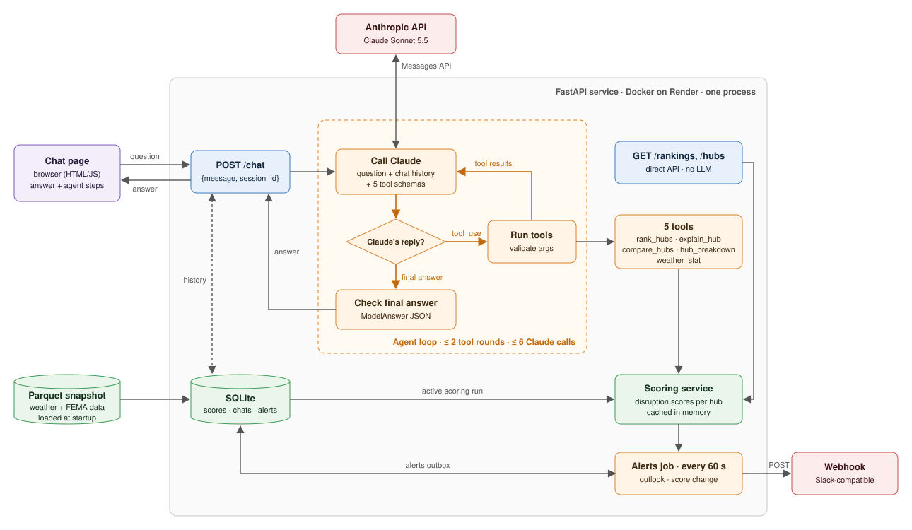

# Weather Risk Intelligence Agent

A logistics company runs regional distribution hubs across the US and each year picks a few hubs for resilience investment. This project ranks the
hubs by **expected weather disruption days per year**, computed by a deterministic rules engine
from public weather and disaster data, and puts a **Claude agent** on top so analysts can ask
questions in plain language and follow up.

```
Which hubs in the Midwest are most exposed to winter disruption?        -> rank_hubs
Compare Miami and Houston in terms of hurricane and flood exposure.      -> compare_hubs
What percentage of days in Denver last year had snowfall?                -> weather_stat
Why is the Dallas hub's weather disruption risk high?                    -> explain_hub
In which month is Denver most disrupted? Compare Boston and Minneapolis by season.  -> hub_breakdown
```

The LLM never produces a number: it chooses tools and writes the explanation. Every number comes
from the engine, and the evals check that.

**Live demo:** https://hub-weather-risk.onrender.com/ (password protected; free hosting plan, so the first
request after 15 idle minutes takes about a minute to wake the service).
**One-page design summary:** [docs/DESIGN_SUMMARY.pdf](docs/DESIGN_SUMMARY.pdf).
**Full sessions with the AI agent (Claude Code):** [section 13](#13-ai-agent-sessions).

## Architecture at a glance



- **One process** serves the chat page, the API, the agent and the alerts. The chat page talks to
  `POST /chat` (and `GET /alerts`); `GET /rankings` and `/hubs` are the deterministic, no-LLM API for
  other consumers (BI, scripts, Swagger at `/docs`).
- **The service never calls a weather API.** At startup it restores the committed parquet snapshot
  into SQLite and serves the active scoring run; the agent's tools read it from memory.
- How the data is refreshed and deployed is part of setup: [section 1](#1-run-it).
  How one chat question flows through the agent: [section 4](#4-the-agent).

---

## Contents
1. [Run it](#1-run-it) · [Deploy to a URL](#1a-deploy-to-a-url-render)
2. [Using the chat](#2-using-the-chat)
3. [The KPI and the scoring engine](#3-the-kpi-and-the-scoring-engine)
4. [The agent](#4-the-agent)
5. [API](#5-api)
6. [Evaluation](#6-evaluation)
7. [Data](#7-data)
8. [Architecture](#8-architecture)
9. [Data storage choice](#9-data-storage-choice)
10. [Repository structure](#10-repository-structure)
11. [Assumptions, limitations and uncertainty](#11-assumptions-limitations-and-uncertainty)
12. [Documentation index](#12-documentation-index)
13. [AI agent sessions](#13-ai-agent-sessions)

---

## 1. Run it

### Option A: deployed to a URL

The live demo is at https://hub-weather-risk.onrender.com/. The browser asks for a login:

| Field | Value |
|---|---|
| User name | any value (for example `demo`); only the password is checked |
| Password | `Omer2106!` |

`/health` is open without a password. Nothing to install and no API key needed. To deploy your own
copy, see [section 1a](#1a-deploy-to-a-url-render).

### Option B: locally with uv (development)

Requirements for running it yourself (options B and C): an Anthropic API key (only the chat and the
evals use it). The weather and disaster data are in the repository (`data/snapshot/`), so nothing is
downloaded at startup.

Install [uv](https://docs.astral.sh/uv/getting-started/installation/) (it installs Python 3.12+ if
needed), clone the repository, and in its folder:

**1. Install dependencies**

```
uv sync
```

**2. Add your API key.** Copy `.env.example` to `.env` (next to `pyproject.toml`) and set
`ANTHROPIC_API_KEY=...` in it.

Windows PowerShell:

```
Copy-Item .env.example .env
```

macOS / Linux:

```
cp .env.example .env
```

**3. Start the server**

```
uv run uvicorn app.main:app --reload
```

- Chat: http://127.0.0.1:8000/
- API docs (Swagger): http://127.0.0.1:8000/docs
- The first start scores all hubs (~1 s) and stores a scoring run; later starts reuse it.

**4. Check everything works without an API key** (offline tests, ~30 s):

```
uv run pytest -q
```

### Option C: with Docker (the same image as the deployment)

```
docker build -t hub-weather-risk .
```

```
docker run -p 8000:8000 --env-file .env hub-weather-risk
```

Then open http://127.0.0.1:8000/. The image contains the app, the rules and the data snapshot; it
runs as a non-root user with a health check on `/health`.

### Refreshing the data (ingestion)

Not needed to run the app: the data is in the repository. Ingestion is an offline command that
downloads from the public APIs, validates the data, writes the parquet snapshot and creates a new
scoring run. Run it on a machine with Open-Meteo quota, then commit the snapshot.

**When to run ingestion:** the first build of the dataset; a data refresh (a new year of weather,
new FEMA declarations: monthly or quarterly is plenty, the KPI is a 5-year average); a hub added to
`config/hubs.yaml` (`--hubs new_id`); a longer history or a new variable; a change in the cleaning
logic. **Never** at server startup, per question, or on Render.

**Why it is separate from the app:** the APIs are slow, rate-limited and sometimes unreachable (the
Open-Meteo free quota ran out during this project); historical data barely changes; questions are
answered in milliseconds from local data; evals run on identical data every time; and a refresh
becomes a new scoring run that can be compared with the previous one (and alerted on).

**A refresh reaching production:** ingest on the laptop -> commit the snapshot -> push -> CI runs
the tests -> Render rebuilds the image -> the app scores the new data at startup.

```
uv run python -m app.ingest --status
uv run python -m app.ingest
```

Options: `--source weather|declarations`, `--hubs denver,miami`,
`--no-score`. **Ingestion ends by creating a new scoring run** if the data changed (never after a
failed ingestion) and prints which hub scores moved; a running server serves it within 5 seconds.

### Settings (`.env`)

| Variable | Default | Meaning |
|---|---|---|
| `ANTHROPIC_API_KEY` | (none) | Required for `/chat` and the evals |
| `LLM_MODEL` | `claude-sonnet-5-5` | Model used by the agent |
| `LLM_EFFORT` | `low` | Thinking effort; the tools do the computing |
| `LLM_THINKING_DISPLAY` | `summarized` | `summarized` returns a readable thinking summary (for the "Agent steps" view); `omitted` returns none |
| `ALERT_WEBHOOK_URL` | (none) | Optional: where alerts are POSTed (Slack-compatible JSON); without it they are stored and shown in the page |
| `ALERTS_TOKEN` | (none) | Optional: token required by `POST /alerts/check` |
| `APP_PASSWORD` | (none) | Optional: password for the whole site (HTTP Basic auth, any user name), except `/health`. Set it on a public URL |
| `OPEN_METEO_API_KEY` | (none) | Optional: paid Open-Meteo key, only for re-downloading weather |

---


## 2. Using the chat

Open http://127.0.0.1:8000/ and ask a question, or click one of the example questions.

- **Left: the conversation.** The model's answer, with a table of at most 10 rows. Follow-up
  questions work ("only the ones in the South, top 3", "how does it compare with Fort Worth?").
- **Right: answer details**, built from the engine's data, never from the model's text:
  the full ranking (or a comparison / breakdown / weather table), confidence, assumptions,
  uncertainty, data sources, the tools that ran with their arguments, raw tool results, tokens.
- **"Agent steps" switch** (header): shows under each answer how the agent worked: the model's
  thinking summary, each tool call, each tool result, retries. Off by default.
- **New conversation** clears the history.

The page is desktop-only by design.

Every question is also saved as a **trajectory file** in `data/trajectories/`. Print the latest
one as a readable timeline:

```
uv run python -m app.agent.trajectory
```

---

## 3. The KPI and the scoring engine

**KPI: expected disruption days per year** per hub (1.0 = one full operating day lost; partial
disruption counts as a fraction). Chosen because it is a business unit an investment committee can
reason about, it adds up across hazards, and it can later be multiplied by a cost per lost day.

Two channels, combined per hazard:

| Channel | Data | What it captures |
|---|---|---|
| **Weather** | Open-Meteo daily reanalysis, 2021-2025 (5 years) | Frequent events: snow, ice, extreme cold, heavy rain, high wind, extreme heat. Rules in `config/disruption.yaml` (e.g. snow >= 7 cm = hub closed + 1 recovery day; gusts >= 75 km/h = docks limited, 0.5 day). Consecutive days form one event; the worst rule per day counts once. |
| **Declarations** | OpenFEMA major-disaster (DR) declarations, 2006-2026 (20 years) | Rare events that 5 years of weather cannot capture: hurricanes / tropical storms (7 days each) and severe storms / tornadoes (1.5 days each). Weather days already covered by a declaration are not counted twice. |

**Standardised index and tiers** (next to the days, not instead of them): index = 100 x days /
4.85, the median hub's total, fixed in `config/disruption.yaml`, so 100 = a typical hub (Dallas
6.08 days -> 125). The same reference is used for each hazard, so hazard indices add up to the
total. Tiers: low < 50, moderate < 100, elevated < 150, high < 200, very high >= 200 (on the
current data 7 / 18 / 13 / 8 / 4 hubs). **Per month and season** the reference is pro-rated (a month
is compared with a typical hub's average month), so Denver's March is 624 (very high) and the 12
monthly indices average to the annual index; stored in the `monthly_scores` table.

Six hazards: winter (snow, ice, cold), flood (extreme rain), high wind, heat, tropical
(hurricanes), severe storms. All thresholds are **expert judgment**, calibrated once against the
real data (`docs/DATA_NOTES.md`), and live in YAML so analysts change numbers, not code.

**Time breakdowns.** The engine keeps every disruption day and every counted disaster as a record,
so the same data answers "by month", "by season" (meteorological: winter = Dec-Feb) and "by year".
Months and seasons always add up to the annual total (tested for all 50 hubs and every hazard).

Current top of the ranking: Boston 13.1 (index 270), Minneapolis 11.7 (242), Denver 10.3 (213),
Milwaukee 10.3 (212), all "very high", winter-driven. Safest: San Diego 0.2 (index 4, low).

**Scores are stored per scoring run** in SQLite (`docs/DATA_MODEL.md`). At startup the server
reuses the active run if the rules and data are unchanged, otherwise it scores and stores a new
one. After editing `config/disruption.yaml`:

```
uv run python -m app.scoring.store --new
uv run python -m app.scoring.store
uv run python -m app.scoring.store --diff 1 2
```

(score again; list runs; what changed between two runs). A running server picks up the new run
within 5 seconds.

Ranking without the LLM, from the command line:

```
uv run python -m app.scoring.report --hazard winter --region Midwest
```

---

## 4. The agent

A hand-written tool-use loop (`app/agent/loop.py`) around Claude Sonnet 5.5.

**Why no agent framework (my choice):** the loop is simple: call the model, run the tools it asks
for, send the results back, repeat. A framework would have added dependency problems and setup
time without a real benefit, and writing it by hand keeps every step visible and logged.

**Five tools** (`app/agent/tools.py`), each named after a type of question:

| Tool | Answers | Key arguments |
|---|---|---|
| `rank_hubs` | which hubs are most exposed / safest | hazard, region, top N, most or least, season or months |
| `explain_hub` | why is a hub high, what drives it | hub; returns rank, median context, drivers, FEMA disasters |
| `compare_hubs` | compare 2-5 hubs | hubs, hazards, season or months (e.g. hurricane season) |
| `hub_breakdown` | when in the year, by season, which year was worst | 1-5 hubs, hazard, by month / season / year |
| `weather_stat` | raw weather facts ("% of days with snowfall") | hubs, variable, count/sum/mean/max/min, condition, year, season or months |

**JSON-schema contract between the LLM and the code:**
- Tool inputs are Pydantic models sent as **strict** JSON schemas, and validated again before running.
  Invalid arguments (a city that is not a hub, a season *and* months) go back to the model as an error.
- The final answer must match `ModelAnswer` (answer text, assumptions, confidence, uncertainty
  notes, data sources) via structured output, and is validated with Pydantic (one retry).
- The ranking is **not** written by the model: the server attaches it from the engine's result
  (`AgentAnswer`). Tools return pre-computed differences and counts, so the model never does arithmetic.

**Guardrails** (from the eval history):
- At most **two rounds of tool calls** per question; a round in which a tool failed does not count,
  so the model can correct its arguments. After that, `tool_choice: none` forces the answer.
  **Why this limit:** it was set to save tokens and budget, because the project ran on my personal
  API usage. It also blocks longer multi-step plans (for example, a question that needs several
  tools one after another). To support those, the limit has to be removed or raised:
  `MAX_TOOL_ROUNDS` in `app/agent/loop.py`, together with `MAX_STEPS` (6 model calls in total).
- A round of only repeated identical calls forces the answer; repeated calls are served from a cache.
- At most 6 model calls per question; refusals use server-side fallback models.

**Prompt caching** is on (the tools and system prompt are identical on every call), which halved the
eval cost.

**Conversation memory:** the last 6 question/answer pairs, stored in SQLite, as plain text.

---

## 5. API

| Endpoint | LLM | Description |
|---|---|---|
| `GET /` | - | The chat page |
| `GET /health` | no | Status, number of hubs scored, active scoring run and data date (no password needed) |
| `GET /health/llm` | no | Checks the API key and the connection to Anthropic without spending tokens |
| `GET /hubs/{hub_id}` | no | Full breakdown of one hub: hazards, drivers, counted FEMA disasters |
| `GET /alerts` | no | Recent alerts (monthly outlooks, score changes) with delivery status |
| `POST /alerts/check` | no | Webhook-triggered outlook check (idempotent); header `X-Alerts-Token` if `ALERTS_TOKEN` is set |
| `POST /chat` | yes | `{"message": "...", "session_id": null}` -> answer, ranking, tool calls, trajectory, tokens |

---

### Alerts (bonus)

Two kinds (policy in `config/alerts.yaml`, details in `docs/DESIGN_DECISIONS.md` section 20):

- **Monthly risk outlook (scheduled):** 7 days before a month starts, **one digest** of the hubs for
  which that month is historically severe: monthly index >= 300 (3x a typical hub's average month)
  with >= 3 past events. Example: January 2027 lists 17 hubs, Boston first (index 964, winter).
- **Score change (event-driven):** when a new scoring run becomes active, the hubs whose index moved
  by >= 25 points or crossed a tier, for the total and per hazard.

Created once (dedup key per month / per run, with a catch-up after downtime) and delivered through
an **outbox** (pending -> claimed with a lease -> delivered, retried every 60 s, at-least-once with an
idempotency key), POSTed to `ALERT_WEBHOOK_URL` if set, always visible at `GET /alerts` and with the
**Alerts** button in the page. Safe with several processes at once (`docs/DESIGN_DECISIONS.md` section 21).

```
uv run python -m app.alerts outlook --month 2027-01
uv run python -m app.alerts list
```

---

## 6. Evaluation

Two layers:

| Layer | Checks | Command | Cost |
|---|---|---|---|
| Unit tests (`tests/`, 92 tests; run on every push by GitHub Actions) | Scoring rules, time breakdowns, index, stored scoring runs, alerts and concurrency, ingestion, API and password, agent loop with a scripted fake Claude, the eval checks and runner | `uv run pytest -q` | free, offline |
| Agent evals (`evals/`, 24 cases / 29 turns) | The real model on edge cases: the 4 assignment questions, a city that is not a hub, "top 100" when only 50 exist, follow-ups, "winter" hazard vs season, safest hubs, worst month, per-year comparison, hurricane season | `uv run python -m evals.run` | ~$0.80 |

Checks on every turn: valid answer format, the right tool with the right arguments, ranking equal
to the engine's, **every number in the answer grounded** in a tool result or the question, counts
("8 of the 10") correct. Each turn's trajectory is saved in `evals/trajectories/`.

Two scores per run: **correctness** (is the answer right?) and **efficiency** (model calls and
latency within budget). Each run is saved in `evals/history/` and compared with the previous one.
Some cases, or every case several times to get pass rates:

```
uv run python -m evals.run --case snowfall_percentage,prompt_injection
uv run python -m evals.run --repeat 3
```

The set has 24 cases: the 4 assignment questions, follow-ups, out-of-scope, "winter" hazard vs
season, safest hubs, months / seasons / years, and robustness (ambiguous and misspelled names,
prompt injection, a system-prompt leak attempt, money and forecasts that must not be invented, a
units trap, a 4-turn conversation).

Results so far (details and what changed after each run in `docs/EVALS.md`):

| Run | Result | Cost | Main finding -> change |
|---|---|---|---|
| 1 | 36/37 | $0.20 | "5 years" not grounded; the model re-typed the ranking -> server attaches the ranking |
| 2-3 | 37/37, 36/37 | $0.16-0.17 | repeated identical tool calls; "top 100" showed 10 rows |
| 4 | 30/33 | $0.15 | new tools: the model looped until the step limit -> forced-answer guardrail |
| 5 | 58/58 | $0.26 | all 4 assignment questions pass |
| 6 | 110/111 | $1.12 | time questions all correct; repeats in 14/17 turns, wandering -> two-round limit |
| 7 | 110/111 | $0.55 | prompt caching halves cost; remaining failure is in the check, not the answer |

---

## 7. Data

| Source | Used for | Coverage |
|---|---|---|
| [Open-Meteo Historical Weather API](https://open-meteo.com/en/docs/historical-weather-api) (ERA5 reanalysis) | daily temperature, rain, snowfall, precipitation, wind gusts | 50 hubs x 1,826 days (2021-2025), 91,300 rows |
| [OpenFEMA Disaster Declarations](https://www.fema.gov/openfema-data-page/disaster-declarations-summaries-v2) | hurricanes, severe storms per county | 47 counties, 669 rows = 481 distinct disasters (2006-2026) |
| `config/hubs.yaml` | the 50 hubs: coordinates, county FIPS, Census region | |

How the data is downloaded and refreshed (ingestion) is part of setup: [section 1](#refreshing-the-data-ingestion).

---

## 8. Architecture

### Components

The component diagram is at the top of this page ([Architecture at a glance](#architecture-at-a-glance)).

- **One process** serves the chat page, the API, the agent and the alerts. The page is a plain client
  of `POST /chat`; the deterministic endpoints (`/rankings`, `/hubs`) answer API clients without the LLM.
- **No weather API at runtime.** SQLite is restored from the committed snapshot at startup and the
  scores come from the active scoring run, so the demo works when a public API is down, answers are
  fast, and evals are repeatable. Refreshing the data is a setup step ([section 1](#refreshing-the-data-ingestion)).

More diagrams: `docs/ARCHITECTURE.md`, `docs/DATA_MODEL.md`. The diagram above is
`docs/img/architecture-1.svg`.

---

## 9. Data storage choice

| Layer | Technology | Contents | Why |
|---|---|---|---|
| Snapshot | Parquet in `data/snapshot/` (828 KB, in git) | Cleaned tables: hubs, daily weather, declarations, ingest log | Reproducible: any clone has exactly the data behind the numbers |
| Database | **SQLite** (`data/weather_risk.db`, rebuilt at startup) | The same tables + chat conversations | Small relational data, SQL for checks, no server to run; one container needs no more |
| Scores | **SQLite scoring tables**, one set per scoring run (`rule_sets`, `scoring_runs`, `hub_results`, `hazard_scores`, `disruption_days`); the active run cached in memory | KPI per hub and hazard, drivers, every disruption day | Every score traceable to the exact rules and data; runs can be compared (risk-change alerts); a new run reaches the running server without a restart |
| Trajectories | JSON files (`data/trajectories/`, `evals/trajectories/`) | Step-by-step record of each question | Easy to open, diff and attach to a bug report |

**Why this setup.** Some of these choices were made so the assignment could be finished by the
deadline and the deployment would be safer:

- **API request limits.** The free Open-Meteo API limits how many requests can be made (it counts a
  long request as several calls), and the quota ran out during this project. So the data is
  downloaded once by the offline ingestion and committed as a snapshot; the app, the tests and the
  evals never spend quota.
- **Deadline.** SQLite and a parquet snapshot in git need no database server to set up, migrate or
  pay for. The time went into the scoring engine, the agent and the evals instead of infrastructure.
- **Safer deployment.** The service calls no weather API at runtime and connects to no external
  database, so there are no database credentials to store or network access to secure, and a slow or
  rate-limited public API cannot break the demo. On every deploy the database is rebuilt from the
  reviewed snapshot in the image, so each deploy starts from known data and a bad database state
  cannot carry over. Everything runs in one container.

The trade-off: chat history and alerts are lost on restart (no persistent disk on the free plan), and
the data is only as fresh as the last snapshot. For production, the scale-out path is described below.

All tables and how they connect: `docs/DATA_MODEL.md` (entity-relationship diagram).

Scale-out path: the target data model in `docs/DATA_MODEL_SCALABLE.md` (Postgres with partitioned
weather per location, versioned rule sets and scoring runs, persisted disruption days and monthly
scores, Redis as the read cache).

---

## 10. Repository structure

```
app/
  main.py               FastAPI: page, /chat, /rankings, /hubs/{id}, /alerts, /health; optional password
  settings.py           settings from .env (Pydantic)
  config.py             loads and validates config/*.yaml
  db.py                 SQLite schema, snapshot restore/export
  ingest.py             offline ingestion CLI (ends with a scoring run)
  alerts.py             monthly outlook and score-change alerts, webhook delivery
  sources/              open_meteo.py, fema_declarations.py
  scoring/
    disruption.py       the rules engine: disruption days per hub and hazard, ranking
    periods.py          month / season / year breakdowns
    store.py            scores in the database: scoring runs, load, compare
    service.py          the active run, cached in memory
    report.py           ranking from the command line
  agent/
    schemas.py          JSON contracts: tool inputs, ModelAnswer, AgentAnswer
    tools.py            the 5 tools
    prompts.py          system prompt
    loop.py             the tool-use loop and guardrails
    trajectory.py       step-by-step records and viewer
  static/index.html     the chat page (no build step, no libraries)
config/
  hubs.yaml             the 50 hubs
  disruption.yaml       disruption rules, thresholds, index reference and tiers
  alerts.yaml           alert policy (thresholds, lead time)
data/
  snapshot/             parquet snapshot (in git)
evals/                  cases.yaml (24 cases), checks.py, run.py, history/, trajectories/
tests/                  offline tests (92)
docs/                   design documents and the one-page PDF summary (section 12)
.github/workflows/      CI: the offline tests on every push
```

---

## 11. Assumptions, limitations and uncertainty

Every answer from the agent carries `assumptions`, `confidence` and `uncertainty_notes`. The main ones:

- **The hub list is my own assumption.** The assignment does not say which hubs the company has, so I
  chose the 50 most populous US cities (Census 2023 city estimates), one hub per city at the city
  centre (`config/hubs.yaml`). Ranks around #48-52 are within a few thousand residents of each
  other, so the cut-off at 50 is approximate.
- **Thresholds are expert judgment**, not calibrated on the company's own downtime data. The KPI is
  for ranking and comparing hubs, not a forecast of lost days. With the company's downtime logs the
  rules should be fitted (`docs/IMPROVEMENTS.md`).
- **5 years of weather is a small sample.** Year-to-year variation is large (Denver: 5.8 to 14.5
  days); per-year and per-month answers say so.
- **Rare events rest on few disasters.** Hurricanes come from 20 years of FEMA declarations (Miami: 4
  hurricanes); the average hides the tail (one Harvey closes a hub for a week or more).
- **Reanalysis is not a weather station.** ~25 km grid cells: snowfall looks ~30% low (thresholds
  lowered to compensate), and coastal hubs (Virginia Beach, Oakland, Boston) get overstated wind;
  flagged in every result for those hubs.
- **Exposure, not risk:** the model does not know hub vulnerability (building standard, backup power,
  alternative routes) or cost in dollars.
- **Out of scope:** weather forecasts, cities that are not hubs, live alerts. The agent says so with
  low confidence instead of guessing.
- "Last year" means 2025, the latest full year in the data; "days with snowfall" means > 0 cm, with
  the >= 1 cm count shown as well; seasons are meteorological.

---

## 12. Documentation index

| Document | Contents |
|---|---|
| `docs/DESIGN_SUMMARY.pdf` | **One-page design and architecture summary**: run instructions, architecture, agent loop, scoring, storage, alerts, repository structure |
| `docs/ARCHITECTURE.md` | Component diagram, one chat question step by step, background flows (startup, new data, alerts), component table |
| `docs/DATA_MODEL.md` | Diagram of every table (source tables, scoring runs, alerts) and how they connect |
| `docs/DATA_MODEL_SCALABLE.md` | Target data model for scale: Postgres, versioned rules and scoring runs, incremental pipeline, migration path |
| `docs/DESIGN_DECISIONS.md` | Every design decision with the options considered and why (API, agent, UI, tools, guardrails, caching, scoring runs, alerts, concurrency) |
| `docs/QUESTION_CATALOG.md` | The questions an analyst will ask, and which tool answers each |
| `docs/EVALS.md` | Eval cases and the analysis of every run |
| `docs/DATA_NOTES.md` | Data quality checks, calibration, known limitations |
| `docs/IMPROVEMENTS.md` | What to build next and why |
| `docs/PLAN.md`, `docs/PLAN-v2-slices.md` | The original plan (historical: written before the build) |
| `docs/HANDOFF.md` | State of the project for continuing in a new AI session |

---

## 13. AI agent sessions

The project was built with Claude Code (Anthropic's coding agent). These links are the full
sessions: the plan, every prompt, the agent's reasoning, tool calls and code changes.

| # | Session |
|---|---|
| 1 | https://claude.ai/code/cshk_011hVRPbfb61h2dKkLurXcKo2F25mKZuBMUTmrVTZEwg3i |
| 2 | https://claude.ai/code/cshk_011hVRPXqiRTcMk6kbKtmVuhXG9K4y9H3WPXBQShT8GP5K |
| 3 | https://claude.ai/code/cshk_011hVRPayq9yfkbEahWCPf9x8UKxB25B9dFPWhyYCcuVx4 |

The plan written at the start of the work is also in the repository: `docs/PLAN.md` (the original
plan) and `docs/PLAN-v2-slices.md` (the build split into slices). `docs/HANDOFF.md` is the summary
used to carry the project from one session to the next.
