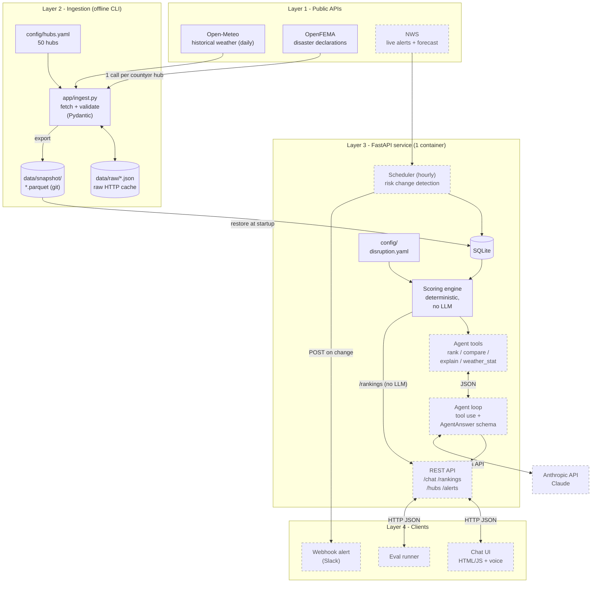
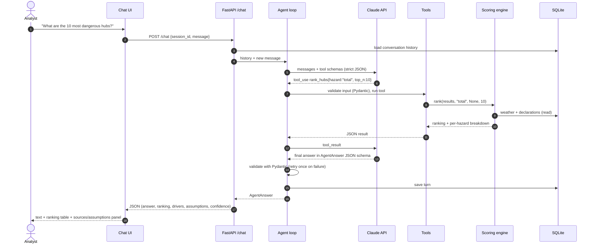

# System architecture

Legend: **solid boxes** are built, **dashed boxes** are planned (later slices).
GitHub renders the diagrams below; PNG/SVG exports are in `docs/img/` (for slides).

## 1. Components and how they talk to each other

**Main design choice: batch ingestion is separate from online serving.** The web service never
calls a weather API to answer a question about history. It reads SQLite, which is rebuilt from
the committed snapshot at startup. As a result the demo works even if a public API is down or
rate-limited, answers are fast, and evals are repeatable.

## 2. One chat question, step by step (planned flow)

The LLM never produces a number: it chooses tools and writes the explanation. All numbers come
from the scoring engine, and the eval checks that the LLM's ranking matches the engine's.

## 3. Component summary

| Component | Technology | Status | Why this choice |
|---|---|---|---|
| Hub list | YAML, validated by Pydantic | built | business config, editable without code |
| Ingestion | Python CLI, httpx + tenacity retries | built | runs where the API quota allows (laptop, cron); decoupled from serving |
| Raw cache | JSON files on disk | built | protects API quota, audit trail ("where did this number come from?") |
| Storage | SQLite + parquet snapshot in git | built | small relational data, no server to run, reproducible |
| Scoring | Pure Python + pandas, rules in YAML | built | deterministic and explainable; analysts edit thresholds, not code |
| Report CLI | `python -m app.scoring.report` | built | ranking without the LLM (sanity check, demo) |
| REST API | FastAPI | planned | Pydantic-native, auto `/docs` |
| Agent | Anthropic SDK, manual tool-use loop | planned | ~100 lines, transparent, no framework to explain |
| Structured output | Pydantic `AgentAnswer` -> JSON schema | planned | one schema for the LLM contract and the validation |
| Chat UI | One static HTML/JS page served by FastAPI | planned | one process, one URL; voice via browser Web Speech API |
| Alerts | APScheduler in-process + webhook POST | planned | no extra infrastructure (a cron would be needed with several replicas) |
| Evals | YAML cases + Python runner | planned | checks tool choice, hubs, ranking fidelity, numbers, scoping |
| Deployment | Docker on Render | planned | one container; DB rebuilt from the snapshot at startup |
