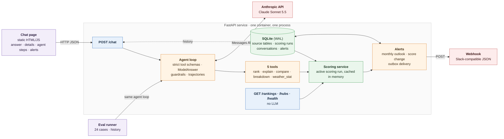
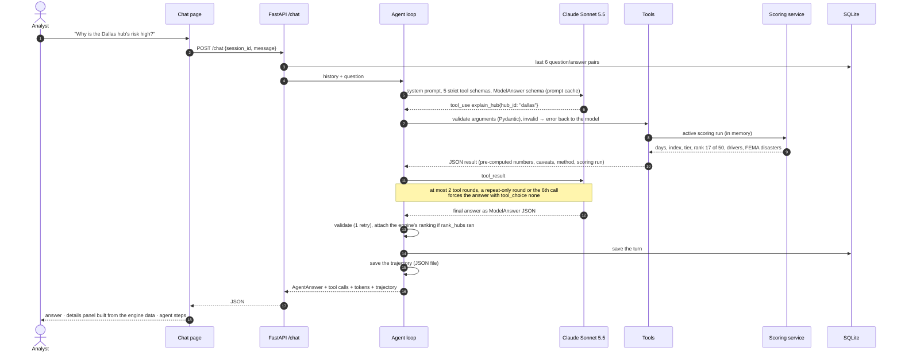
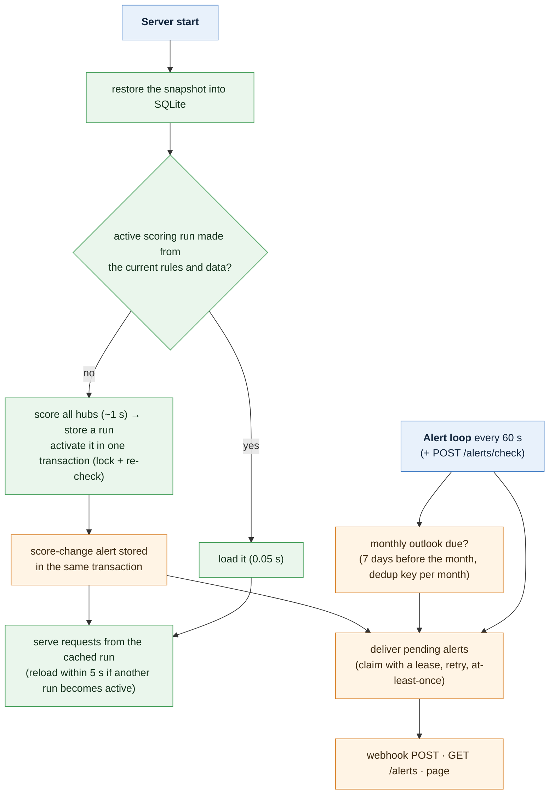

# System architecture

Everything below is built and running (live: https://hub-weather-risk.onrender.com/, password protected).
GitHub renders the diagrams; PNG/SVG exports are in `docs/img/` (`architecture-1`, `architecture-2`,
`architecture-3`). A one-page summary is in `docs/DESIGN_SUMMARY.pdf`; the reasons behind every choice
are in `docs/DESIGN_DECISIONS.md`.

## 1. Components and how they talk to each other

**Main design choice: no weather API at runtime.** The service never calls a weather API to answer
a question. It starts from the committed parquet snapshot, so the demo works when a public API is
down or rate-limited, answers are fast, and evals run on identical data every time. How the data is
downloaded, refreshed and deployed is a setup step (README section 1, "Refreshing the data").
`GET /rankings` and `/hubs` are the deterministic API for other consumers (BI, scripts, Swagger at
`/docs`); the chat page uses `POST /chat` and `GET /alerts`.

## 2. One chat question, step by step

The LLM never produces a number: it chooses tools and writes the explanation; every number comes from
the engine, and the evals check it (`docs/EVALS.md`).

## 3. Background flows: startup, scoring runs, alerts

## 4. Component summary

| Component | Technology | Why this choice |
|---|---|---|
| Hub list | `config/hubs.yaml`, validated by Pydantic | business config, editable without code |
| Storage | parquet snapshot in git (restored at startup) + SQLite (WAL) | small relational data, no server to run, reproducible; plain SQL for a later Postgres move |
| Scoring engine | pure Python + pandas, rules in `config/disruption.yaml` | deterministic and explainable; analysts edit thresholds, not code |
| Scoring runs | SQLite tables, one set per run (rules hash + data fingerprint) | every score traceable and comparable; computed on write, cached in memory |
| Index and tiers | fixed reference in the rules (100 = median hub) | comparable, stable scores; pro-rated per month and season |
| REST API | FastAPI | Pydantic-native, `/docs`, one process for page, API and agent |
| Agent | Anthropic SDK, hand-written tool-use loop | transparent, every step logged (trajectories); guardrails from the eval history |
| JSON contract | Pydantic tool inputs (strict) + `ModelAnswer` structured output | one definition for the schema sent to Claude and the validation |
| Chat page | one static HTML/JS page (desktop) | no build step, a plain client of `POST /chat`; details built from engine data |
| Alerts | in-process loop + `POST /alerts/check`, outbox table, webhook | no extra infrastructure; exactly-once creation, at-least-once delivery |
| Evals | YAML cases + Python runner, history and comparison | correctness vs efficiency, pass rates over repeats |
| CI | GitHub Actions | the offline tests on every push |
| Deployment | Docker on Render (Blueprint), optional site password | one container; the snapshot is in the image; auto-deploy on push |
