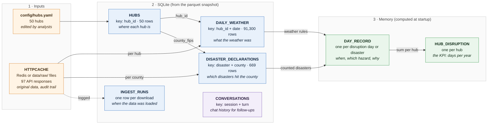

# Data model: tables and how they connect

The data flows left to right: inputs (the hub list and the raw API cache), the SQLite tables
(restored from the committed parquet snapshot at startup), and the objects the scoring engine
keeps in memory. PNG/SVG exports: `docs/img/data-model.png`, `docs/img/data-model.svg`.

## Purpose of each table

| Table | Layer | Purpose | Written by | Read by |
|---|---|---|---|---|
| `HTTPCACHE` | Redis (`REDIS_URL`) or `data/raw/*.json` (git) | Original API responses, never expire: audit trail and quota protection | ingestion | ingestion only |
| `HUBS` | SQLite + parquet snapshot | The 50 hubs: location, county, Census region; the table everything joins to | ingestion (from `config/hubs.yaml`) | engine, API |
| `DAILY_WEATHER` | SQLite + parquet snapshot | One row per hub per day, 2021-2025 | ingestion (Open-Meteo) | engine, `weather_stat` |
| `DISASTER_DECLARATIONS` | SQLite + parquet snapshot | FEMA disasters per county since 2006: the rare events 5 years of weather cannot show | ingestion (OpenFEMA) | engine |
| `INGEST_RUNS` | SQLite + parquet snapshot | Log of every download (source, rows, cache or API, status) | ingestion | `ingest --status`, audit |
| `CONVERSATIONS` | SQLite only (not committed) | Chat history, so follow-up questions have context | `/chat` | `/chat` (last 6 turns) |
| `DAY_RECORD` | memory | Every disruption day and counted disaster after the rules: the source of all time breakdowns | engine at startup | month / season / year tools |
| `HUB_DISRUPTION` | memory | The KPI per hub, split by hazard, with drivers | engine at startup | all tools, `/rankings`, `/hubs` |

## Columns

| Table | Columns (key in bold) |
|---|---|
| `HTTPCACHE` | **key** (`httpcache:<source>:<hash>`), url, params (API key excluded), fetched_at, data (raw body) |
| `HUBS` | **hub_id**, city, state, lat, lon, county_fips, region, pop_rank |
| `DAILY_WEATHER` | **hub_id**, **date**, tmax, tmin (C), precip_sum, rain_sum (mm), snowfall_sum (cm), wind_gusts_max, wind_speed_max (km/h), weather_code |
| `DISASTER_DECLARATIONS` | **disaster_number**, **county_fips**, incident_type, declaration_type (DR / EM / FM), title, declaration_date, incident_begin_date |
| `INGEST_RUNS` | **run_id**, source, params, started_at, finished_at, rows, status, detail (cache or API + cache location) |
| `CONVERSATIONS` | **session_id**, **turn**, role, content, created_at |
| `DAY_RECORD` | hub, date, hazard, value (severity, or days per disaster), channel (weather / declarations), label (rule), event |
| `HUB_DISRUPTION` | **hub_id**, total_days_per_year, hazards (days, drivers, events per hazard), declarations_counted, weather_coverage |

## Connections worth knowing
- **Hubs to declarations is many-to-many through the county.** 50 hubs sit in 47 counties
  (Phoenix and Mesa share Maricopa County, Los Angeles and Long Beach share Los Angeles County,
  Fort Worth and Arlington share Tarrant County), and a county has many disasters. It is a join on
  `county_fips`, not a foreign key.
- **One cache entry per API request:** Open-Meteo is fetched per hub (one response = 1,826 daily
  rows), OpenFEMA per county.
- **`DAY_RECORD` is the bridge to time breakdowns:** the annual KPI and every month, season or year
  breakdown are sums over the same records, so they always agree.
- **Not shown:** `hub_scores` exists in the schema but is no longer written (scores moved to memory);
  it is the natural place to store score history for the planned risk-change alerts.
  Chat trajectories are JSON files (`data/trajectories/`), not a table.

For the design at scale (thousands of hubs, decades of data, versioned rules), see `docs/DATA_MODEL_SCALABLE.md`.
