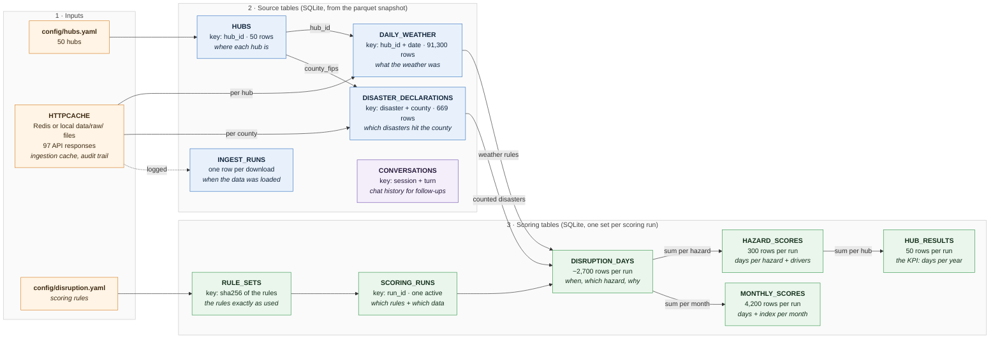

# Data model: tables and how they connect

The data flows left to right: inputs (the hub list and the raw API cache), the source tables in
SQLite (restored from the committed parquet snapshot at startup), and the **scoring tables**, where
every score is stored with the scoring run that produced it. The running server keeps the active
run in memory as a cache. PNG/SVG exports: `docs/img/data-model.png`, `docs/img/data-model.svg`.

## Purpose of each table

| Table | Layer | Purpose | Written by | Read by |
|---|---|---|---|---|
| `HTTPCACHE` | Redis (`REDIS_URL`) or local `data/raw/*.json` (not in git) | Original API responses, never expire: audit trail and quota protection | ingestion | ingestion only |
| `HUBS` | SQLite + parquet snapshot | The 50 hubs: location, county, Census region; the table everything joins to | ingestion (from `config/hubs.yaml`) | engine, API |
| `DAILY_WEATHER` | SQLite + parquet snapshot | One row per hub per day, 2021-2025 | ingestion (Open-Meteo) | engine, `weather_stat` |
| `DISASTER_DECLARATIONS` | SQLite + parquet snapshot | FEMA disasters per county since 2006: the rare events 5 years of weather cannot show | ingestion (OpenFEMA) | engine |
| `INGEST_RUNS` | SQLite + parquet snapshot | Log of every download (source, rows, cache or API, status) | ingestion | `ingest --status`, audit |
| `CONVERSATIONS` | SQLite only (not committed) | Chat history, so follow-up questions have context | `/chat` | `/chat` (last 6 turns) |
| `ALERTS` | SQLite only (not committed) | Every alert sent or stored, with a unique dedup key and delivery status | alerts (outlook, score change) | `GET /alerts`, the page |
| `RULE_SETS` | SQLite (scoring) | Every version of the scoring rules ever used, keyed by their hash | scoring | audit, run comparison |
| `SCORING_RUNS` | SQLite (scoring) | One scoring pass: rule set, data fingerprint, data as of, status; exactly one is `active` | scoring | the service (which run to serve) |
| `DISRUPTION_DAYS` | SQLite (scoring) | Every disruption day and counted disaster after the rules: the source of all time breakdowns | scoring | month / season / year tools |
| `HAZARD_SCORES` | SQLite (scoring) | Days per year per hub and hazard, with the rules behind them (drivers) | scoring | all tools, run comparison |
| `HUB_RESULTS` | SQLite (scoring) | The KPI per hub, data coverage, FEMA disasters counted | scoring | all tools, `/rankings`, `/hubs` |
| `MONTHLY_SCORES` | SQLite (scoring) | Days per year, index and tier per hub, hazard (and total) and month | scoring | SQL, dashboards (same values as `hub_breakdown`) |

## Columns

| Table | Columns (key in bold) |
|---|---|
| `HTTPCACHE` | **key** (`httpcache:<source>:<hash>`), url, params (API key excluded), fetched_at, data (raw body) |
| `HUBS` | **hub_id**, city, state, lat, lon, county_fips, region, pop_rank |
| `DAILY_WEATHER` | **hub_id**, **date**, tmax, tmin (C), precip_sum, rain_sum (mm), snowfall_sum (cm), wind_gusts_max, wind_speed_max (km/h), weather_code |
| `DISASTER_DECLARATIONS` | **disaster_number**, **county_fips**, incident_type, declaration_type (DR / EM / FM), title, declaration_date, incident_begin_date |
| `INGEST_RUNS` | **run_id**, source, params, started_at, finished_at, rows, status, detail (cache or API + cache location) |
| `CONVERSATIONS` | **session_id**, **turn**, role, content, created_at |
| `ALERTS` | **alert_id**, kind (outlook / change), dedup_key (unique), run_id, title, message, payload_json, created_at, status (pending / delivered / failed / stored), attempts, lease_until, delivered_at, delivery_error |
| `RULE_SETS` | **rule_set_id**, sha256 (unique), rules_yaml, first_used_at |
| `SCORING_RUNS` | **run_id**, rule_set_id, data_fingerprint, data_as_of, status (running / active / superseded), hubs, started_at, finished_at |
| `DISRUPTION_DAYS` | **run_id**, **hub_id**, **date**, **hazard**, **event**, value, channel (weather / declarations), label (rule) |
| `HAZARD_SCORES` | **run_id**, **hub_id**, **hazard**, label, days_per_year, index_value, tier, from_weather, from_declarations, events_per_year, drivers_json |
| `MONTHLY_SCORES` | **run_id**, **hub_id**, **hazard** (or total), **month**, days_per_year, index_value (100 = a typical hub's average month), tier |
| `HUB_RESULTS` | **run_id**, **hub_id**, total_days_per_year, index_value, tier, weather_complete, weather_coverage, weather_period, weather_years, declaration_years, weather_days_deduplicated, declarations_json |

## How scoring runs work
- **At startup** the service checks whether the active run was computed from the current rules
  (hash of `config/disruption.yaml`) and the current data (hash of the snapshot files). If yes, it
  loads it (0.05 s); if not, it scores (1.1 s), stores a new run (0.02 s) and makes it active.
- **A run becomes active in one transaction** with its inserts, so readers never see a half-written run.
- **The running server checks every 5 s** whether another run became active and reloads it, so
  `uv run python -m app.scoring.store --new` (after editing the rules) reaches it without a restart.
- **Every tool result carries `scoring_run`**, and `/health` shows the active run and its data date.
- **Comparing runs:** `uv run python -m app.scoring.store --diff 1 2` lists the hubs and hazards whose
  days per year changed (the basis for risk-change alerts).

## Connections worth knowing
- **Hubs to declarations is many-to-many through the county.** 50 hubs sit in 47 counties
  (Phoenix and Mesa share Maricopa County, Los Angeles and Long Beach share Los Angeles County,
  Fort Worth and Arlington share Tarrant County), and a county has many disasters. It is a join on
  `county_fips`, not a foreign key.
- **One cache entry per API request:** Open-Meteo is fetched per hub (one response = 1,826 daily
  rows), OpenFEMA per county.
- **`DISRUPTION_DAYS` is the bridge to time breakdowns:** the annual KPI and every month, season or
  year breakdown are sums over the same records, so they always agree.
- **The scoring tables are derived, so they are not in the snapshot:** a fresh clone scores once at
  first startup. Chat trajectories are JSON files (`data/trajectories/`), not a table.

For the design at scale (thousands of hubs, decades of data, Postgres, incremental scoring), see
`docs/DATA_MODEL_SCALABLE.md`.
