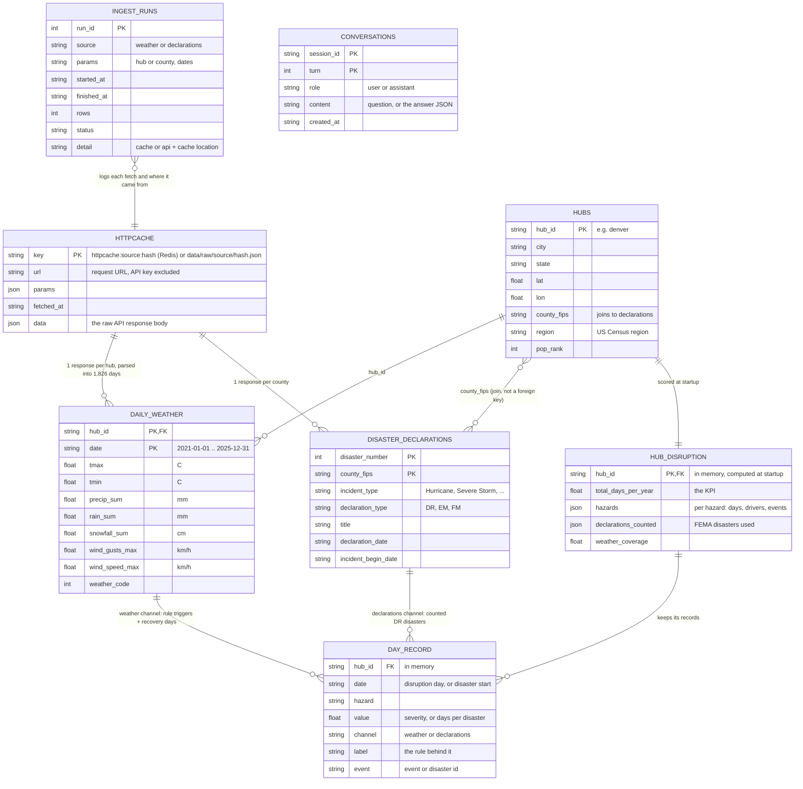

# Data model: tables and how they connect

All data the system stores, across its storage layers (see README section 9):
the raw API cache (Redis or `data/raw/` files), the SQLite tables (restored from the committed
parquet snapshot at startup), and the objects the scoring engine keeps in memory.
PNG/SVG exports: `docs/img/data-model.png`, `docs/img/data-model.svg`.

## Tables

| Table | Storage | Rows | Written by | Read by |
|---|---|---|---|---|
| `httpcache` | Redis (`REDIS_URL`) or `data/raw/*.json` (git) | 97 (50 + 47) | ingestion | ingestion only |
| `hubs` | SQLite, from `config/hubs.yaml`; parquet snapshot | 50 | ingestion | engine, API |
| `daily_weather` | SQLite; parquet snapshot | 91,300 | ingestion (Open-Meteo) | engine, `weather_stat` |
| `disaster_declarations` | SQLite; parquet snapshot | 669 rows: 481 distinct disasters, one row per disaster and county | ingestion (OpenFEMA) | engine |
| `ingest_runs` | SQLite; parquet snapshot | one per fetch | ingestion | `--status`, audit |
| `conversations` | SQLite only (not committed) | 2 per chat question | `/chat` | `/chat` (last 6 turns) |
| `HubDisruption` | memory | 50 | engine at startup | all tools, `/rankings`, `/hubs` |
| `DayRecord` | memory (inside `HubDisruption`) | one per disruption day or counted disaster | engine | month / season / year breakdowns |

## Connections worth knowing
- **Hubs to declarations is many-to-many through the county.** 50 hubs sit in 47 counties
  (Phoenix and Mesa share Maricopa County, Los Angeles and Long Beach share Los Angeles County,
  Fort Worth and Arlington share Tarrant County),
  and a county has many disasters. It is a join on `county_fips`, not a foreign key.
- **One cache entry per API request:** Open-Meteo is fetched per hub (one response = 1,826 daily
  rows), OpenFEMA per county. The cache key hashes the URL and parameters (API key excluded).
- **`DayRecord` is the bridge to time breakdowns:** every disruption day (weather) and every counted
  disaster (declarations) is one record, so the annual KPI and every month, season or year
  breakdown are sums over the same records.
- **Not shown:** `hub_scores` exists in the schema but is no longer written (scores moved to memory);
  it is the natural place to store score history for the planned risk-change alerts.
  Chat trajectories are JSON files (`data/trajectories/`), not a table.
