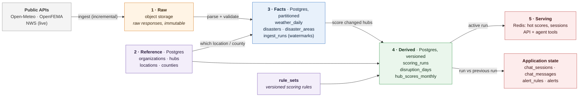
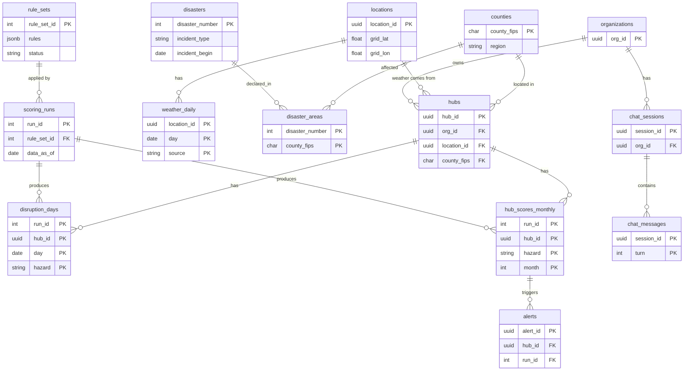

# Data model for scale: the target design

`docs/DATA_MODEL.md` describes what runs today: 50 hubs, 5 years of daily weather, SQLite rebuilt
from a snapshot, scores recomputed in memory at startup. That is the right size for a prototype.
This document is the design for when the product grows. It is a **design, not yet implemented**;
the last section gives a migration path in small steps.

## 1. What "scale" means here

| Dimension | Today | Target | What breaks today |
|---|---|---|---|
| Hubs | 50, one company | 10,000+, several companies | full recompute at startup (1.1 s -> minutes); memory |
| Weather history | 5 years, daily | 20-40 years, daily (later hourly) | SQLite file size; full reload on every start |
| Data refresh | manual batch | daily incremental + live alerts | snapshot rebuild; scores stale until restart |
| Scoring rules | one YAML, edited in place | versioned, reviewed, A/B compared | cannot reproduce last month's score |
| App instances | 1 container | many replicas | SQLite and in-memory state are per process |
| Questions | ad hoc chat | chat + dashboards + alerts | every number recomputed or held in RAM |

Rough volume at target: 10,000 hubs x 30 years x 365 days = **110 M weather rows** (daily; ~1 GB
in Postgres, ~1 GB compressed hourly x24 in a columnar store); disruption days ~0.5 % of weather
rows per rule run (~0.6 M); scores 10,000 hubs x 7 hazards x 12 months per run (~0.8 M).

## 2. Design principles

1. **Weather belongs to a place, not to a hub.** Hubs come and go and several hubs (and several
   customers) share one weather grid cell. Store weather per `location`; hubs point to a location.
   One download serves every hub in that cell.
2. **Normalise the facts, version the logic, materialise the results.** Raw facts are written
   once; rules are versioned rows; every derived number carries the run that produced it.
3. **Every number is reproducible:** a score = (data as of a date) x (rule set version). Both are
   recorded on the score, so "why did Dallas change since last month?" has an answer.
4. **Incremental, not full rebuilds:** ingestion appends new days per location from a watermark;
   scoring recomputes only the hubs whose inputs changed.
5. **Right store per access pattern:** object storage for raw files, Postgres for the relational
   core and time series (partitioned), Redis for hot reads, never as the source of truth.

## 3. Layers

## 4. Tables and keys

| Table | Purpose | Key / partitioning | Change from today |
|---|---|---|---|
| `organizations` | Customers (multi-tenant) | `org_id` | new |
| `hubs` | A customer's hub: name, address, active from/to | `hub_id`; FK org, location, county | was keyed by city name; now one company's hub, not "the city" |
| `locations` | A weather grid cell (snapped lat/lon) | `location_id`; unique (grid_lat, grid_lon) | new: weather shared by every hub in the cell |
| `counties` | FIPS, state, Census region | `county_fips` | new: region lives here, not on the hub |
| `weather_daily` | One row per location, day and source; one column per variable | (location_id, day, source); **range-partitioned by year**, BRIN on day | was keyed by hub |
| `disasters` | One row per FEMA disaster | `disaster_number` | split from today's table (481 disasters stored as 669 rows) |
| `disaster_areas` | Which counties a disaster covers | (disaster_number, county_fips) | new link table |
| `ingest_runs` | Every fetch: source, location/county, date range, rows, status, raw object key, **watermark** | `run_id` | adds watermarks for incremental ingestion |
| `rule_sets` | The YAML rules as a versioned row (draft / active / retired, author, created_at) | `rule_set_id` | was a file edited in place |
| `scoring_runs` | One scoring pass: rule set, data as of, status, timing | `run_id` | new: every number points to its run |
| `disruption_days` | Today's `DayRecord`, persisted: hub, day, hazard, value, channel, rule label, event id | (run_id, hub_id, day, hazard); partitioned by run | was rebuilt in memory on every start |
| `hub_scores_monthly` | Expected days per hub, hazard, month (sum per year/season/total by `GROUP BY`) | (run_id, hub_id, hazard, month) | replaces the unused `hub_scores` and the in-memory scores |
| `alert_rules`, `alerts` | Who to notify and when a hub's score moved between two runs | `alert_id` | new (the alerts bonus) |
| `chat_sessions`, `chat_messages`, `agent_traces` | Chat history per org/user; trajectories as JSONB (or tracing) | `session_id`, (session_id, turn) | split from `conversations`; traces were JSON files |

## 5. Design decisions

**Why scores by month, not by year.** `hub_scores_monthly` is the smallest grain every tool needs:
a year is `SUM` over 12 rows, a season over 3, "hurricane season" over 6. One table answers all the
time questions with an indexed `GROUP BY`, instead of scanning day records.
Day-level questions ("January 2024 in Dallas") read `disruption_days`, which is small.

**Why persist `disruption_days`.** It is the explanation behind every number ("which days, which
rule"). Persisting it makes explanations, per-year answers and audits SQL queries, and lets
dashboards use it without the engine. Retention: keep the active run and the previous few.

**Why version rules and runs.** A score is only meaningful with its rule version and data date.
With `scoring_runs`, changing a threshold creates a new run; both can be compared side by side
before the new one becomes active, and alerts compare "this run vs the previous active run".

**Wide or long weather table.** Wide (one column per variable) is chosen: the variables are a fixed,
small set, scans are faster and the SQL is simpler. A new variable is a migration (rare). Long
format (variable, value) would suit hundreds of changing variables.

**Postgres partitions or a time-series database.** Native range partitioning by year is enough for
~100 M daily rows (old partitions are read-only and compress well). TimescaleDB, or a columnar
store (DuckDB / BigQuery) for the weather facts, becomes worth it with hourly data or heavy
analytical scans. Partitioning keeps that move open.

**Raw data in object storage, not Redis or git.** Raw responses grow with every refresh and are read
rarely (audits, re-parsing). Object storage is cheap, immutable and durable; the object key is
stored on `ingest_runs`. Redis keeps only hot, recomputable data (latest scores per hub, sessions,
rate limits), so losing it costs latency, never correctness.

**Incremental pipeline.**
1. Ingest: per location, fetch days after the watermark; append to `weather_daily`.
2. Score: find hubs whose location or county got new data (or a new rule set); recompute only those
   into a new `scoring_run`. Events crossing the watermark are recomputed from a few days back.
3. Publish: mark the run active; refresh Redis; compare with the previous run and raise alerts.

## 6. How the app reads it

| Question | Today | Target |
|---|---|---|
| Rank hubs (any hazard, region, season) | in-memory sort | `SELECT hub_id, SUM(days) ... FROM hub_scores_monthly WHERE run_id = :active AND month IN (...) GROUP BY hub_id ORDER BY 2 DESC LIMIT n` (Redis for the common ones) |
| Explain a hub | in memory | `hub_scores_monthly` + `disruption_days` + `disasters` for that hub |
| By month / season / year | in-memory records | `GROUP BY month` / season / `EXTRACT(year FROM day)` |
| % of days with snowfall | pandas over memory | `SELECT COUNT(*) FILTER (WHERE snowfall_cm > 0) ... FROM weather_daily` (one partition) |
| Did a hub's risk change? | not possible | compare two `scoring_runs` |

## 7. Migration path from today (each step works on its own)

1. **Normalise what we have, still SQLite:** `disasters` + `disaster_areas`; `locations` and
   `counties`; weather keyed by location. Snapshot and tests unchanged in spirit.
2. **Version the logic:** `rule_sets` and `scoring_runs`; persist `disruption_days` and
   `hub_scores_monthly`; the tools read tables instead of memory. Enables the alerts bonus.
3. **Postgres:** same schema (plain SQL today, so the move is mechanical), partitions by year,
   `DATABASE_URL` setting; SQLite kept for local development and tests.
4. **Incremental ingestion and scheduler:** watermarks, a daily job, alerts on score changes.
5. **Raw responses to object storage; Redis as the read cache** for hot scores and sessions.
6. **Multi-tenant:** `organizations`, org-scoped hubs and chats, row-level security in Postgres.
